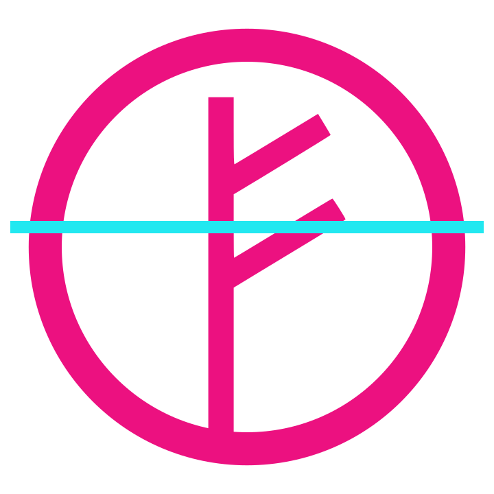

  <picture>
    <source media="(prefers-color-scheme: dark)" srcset="assets/raio-x-logo-escuro.svg">
    
  </picture>

# Raio-x da marca reconhecível

Skill para Claude que executa o Raio-x da marca reconhecível, método de Amanda Noronha para medir se uma marca é encontrada, entendida e escolhida em busca tradicional e em respostas de sistemas de IA.

**Versão da metodologia:** 1.1.0, aprovada em 04/11/2026.
**Página da ferramenta:** https://amandanoronha.com.br/ferramentas/raio-x-da-marca-reconhecivel/

## O que a skill faz

A skill audita um domínio em 92 verificações, agrupadas em sete sintomas e organizadas pelas cinco camadas da Arquitetura Cognitiva do SEO: Rastreabilidade, Estrutura, Interpretação, Memória e Ação.

Cada verificação registra a evidência coletada: URL, trecho, valor encontrado e data. Nenhum item recebe "cumpre" sem evidência. O que depende de acesso que a sessão não tem fica como não avaliado, com a instrução do que falta.

A nota vai de 0 a 35, com cobertura e confiabilidade informadas ao lado. As faixas são Ausente, Citada e Reconhecida, e continuam provisórias até a calibração.

**Entregáveis:** relatório em PDF, planilha .xlsx com fórmulas que recalculam e um JSON da avaliação.

## Os sete sintomas

| Sintoma | Camada |
|---|---|
| 01 Entidade inconsistente | 4 Memória |
| 02 Dados ilegíveis por agente | 2 Estrutura |
| 03 Ausência entre plataformas | 4 Memória |
| 04 Confiança não verificável | 5 Ação |
| 05 Distância vetorial do público | 3 Interpretação |
| 06 Presença não recorrente | 4 Memória |
| 07 Conteúdo fora de alcance | 1 Rastreabilidade |

## Como usar

1. Compacte a pasta `raio-x-marca-reconhecivel/` em um arquivo .zip, mantendo o `SKILL.md` e o `logo.png` dentro dela. O mesmo pacote também está disponível na página da ferramenta.
2. Envie o .zip para o Claude seguindo o passo a passo oficial: https://support.claude.com/en/articles/12512180-using-skills-in-claude
3. Numa conversa, peça o raio-x de um domínio. O `SKILL.md` traz um modelo de prompt com todas as entradas.

Quem roda a auditoria é a pessoa usuária. Amanda Noronha aparece no relatório como criadora do método e da ferramenta.

## Histórico de versões

- **1.1.0, 04/11/2026:** 92 verificações em sete sintomas, nota de 0 a 35. Entra o sintoma 07, Conteúdo fora de alcance, na camada de Rastreabilidade.
- **1.0:** 80 verificações em seis sintomas, nota de 0 a 30. É a versão usada no autodiagnóstico da página da ferramenta e nos slides da palestra no SEO Summit 2026.

## Como citar

NORONHA, Amanda. **Raio-x da marca reconhecível**: skill para Claude. Versão 1.1.0. 2026. O DOI do Zenodo é atribuído a cada release; consulte o arquivo `CITATION.cff` e o selo do Zenodo neste repositório.

Palestra relacionada: NORONHA, Amanda. A ciência de quem a IA recomenda primeiro. SEO Summit 2026, São Paulo, 5 nov. 2026. DOI: 10.5281/zenodo.24062557.

## Licença

Creative Commons Atribuição-NãoComercial-CompartilhaIgual 4.0 Internacional (CC BY-NC-SA 4.0). Você pode usar, copiar e adaptar a skill para fins não comerciais, com crédito a Amanda Noronha e com a mesma licença nas adaptações. Uso comercial depende de autorização da autora, pelo contato em https://amandanoronha.com.br.

Texto completo da licença: https://creativecommons.org/licenses/by-nc-sa/4.0/legalcode.pt
